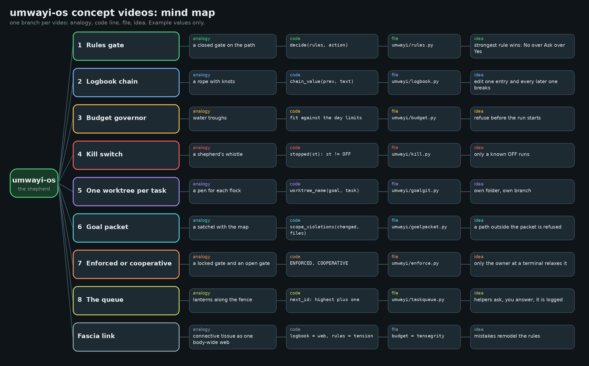

# umwayi-os concept videos: mind map

One branch per video. Code lines are from umwayi-os at commit 985b1b3, some shortened to fit the video panel. Numbers in the videos are examples.

| Video | Analogy | Code | File | Idea |
|---|---|---|---|---|
| 1 Rules gate | a closed gate on the path | decide(rules, action) | umwayi/rules.py | strongest rule wins: No over Ask over Yes |
| 2 Logbook chain | a rope with knots | chain_value(prev, text) | umwayi/logbook.py | edit one entry and every later one breaks |
| 3 Budget governor | water troughs | fit against the day limits | umwayi/budget.py | refuse before the run starts |
| 4 Kill switch | a shepherd's whistle | stopped(st): st != OFF | umwayi/kill.py | only a known OFF runs |
| 5 One worktree per task | a pen for each flock | worktree_name(goal, task) | umwayi/goalgit.py | own folder, own branch |
| 6 Goal packet | a satchel with the map | scope_violations(changed, files) | umwayi/goalpacket.py | a path outside the packet is refused |
| 7 Enforced or cooperative | a locked gate and an open gate | ENFORCED, COOPERATIVE | umwayi/enforce.py | only the owner at a terminal relaxes it; today the mode is recorded, the parts are built in steps |
| 8 The queue | lanterns along the fence | next_id: highest plus one | umwayi/taskqueue.py | helpers ask, you answer, it is logged |

Fascia link (see fascia-living-network.md): the logbook is the continuous web, rules are tension, budget and limits are tensegrity, caught mistakes remodel the rules.

Next: later pull request explainer videos reuse the same layout and tones (script: scenes.py, kept in the UMWAYI project docs).
